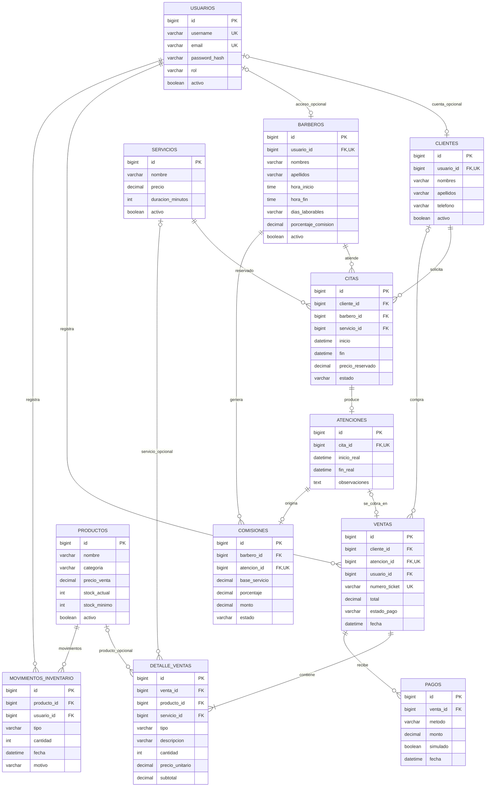

# BarberManager — Especificación funcional y técnica

**Versión:** 1.0 (propuesta para revisión y aprobación del equipo)  
**Proyecto:** Sistema web de gestión de barbería  
**Alcance:** Una barbería; portal público + panel interno; pagos completamente simulados y ticket interno.  
**Equipo:** Líder del proyecto (Israel); Gerald (Frontend); Alexander (Backend); Jybran (Base de datos).  
**Repositorio:** https://github.com/VerdeZif/BarberManager

> **Fuente de verdad del alcance:** este documento describe la versión académica acordada. Los cambios de procesos, nombres de tablas o estados se proponen mediante Pull Request y se aprueban antes de implementarse.

## 1. Resumen y objetivos

BarberManager permite gestionar usuarios, clientes, barberos, servicios, reservas, atenciones, productos, inventario, ventas, pagos **simulados**, comisiones y reportes básicos. Incluye catálogo público y reserva para clientes registrados, así como paneles para administrador, recepcionista y barbero.

**Objetivo general:** simplificar la operación de una barbería mediante reservas sin cruces de horario, trazabilidad de las atenciones y simulación del cobro con emisión de un ticket interno.

**Objetivos específicos:**

1. Mantener información centralizada de clientes, barberos y servicios.
2. Permitir reservar un servicio con un barbero en un horario disponible.
3. Controlar estados de citas y atenciones.
4. Registrar productos, movimientos de existencias y ventas.
5. Simular uno o más pagos de una venta y emitir un ticket imprimible.
6. Calcular comisiones por servicios atendidos y cobrados.
7. Consultar indicadores básicos mediante un dashboard.

**Fuera de alcance (v1):** múltiples sedes, varios servicios en una sola cita, asignación de especialidades por barbero, horarios semanales complejos/ausencias individuales, proveedores, pasarelas bancarias reales, notificaciones SMS/WhatsApp automáticas, facturación electrónica SUNAT, boletas fiscales, devoluciones/reembolsos automatizados y liquidaciones de comisión agrupadas.

## 2. Tecnologías y arquitectura

- Java 17, Jakarta Servlet 6.0, JSP/JSTL, JPA/Hibernate, Maven.
- HTML, CSS, JavaScript, Bootstrap 5.
- Apache Tomcat 10.1.x para ejecutar el WAR.
- MySQL 8 o MariaDB de XAMPP, **sujeto a confirmar versión y compatibilidad del dialecto JDBC/JPA antes de generar el SQL definitivo**.
- GitHub con ramas `main`, `develop`, `frontend-gerald`, `backend-alexander`, `database-jybran`.
- Capas: `controller` (Servlets), `service` (negocio/transacciones), `dao` (persistencia), `model` (entidades JPA), `filter` (sesiones y permisos), vistas JSP bajo `WEB-INF/views`.
- **Moneda:** soles (PEN, S/); **zona horaria:** `America/Lima`.

## 3. Actores y permisos

| Acción | Administrador | Recepcionista | Barbero | Cliente |
|---|:---:|:---:|:---:|:---:|
| Acceder al panel interno | Sí | Sí | Sí | No |
| Administrar usuarios y roles | Sí | No | No | No |
| Administrar clientes | Sí | Sí | No | Sus propios datos |
| Administrar barberos, servicios y precios | Sí | No | No | No |
| Consultar/crear citas | Todas | Todas | Propias (consulta) | Propias |
| Confirmar/reprogramar/cancelar citas | Sí | Sí | No | Cancelar propias futuras* |
| Registrar inicio y fin de atención | Sí | Sí | Solo propias | No |
| Controlar inventario y registrar ventas | Sí | Sí | No | No |
| Registrar pagos simulados/emitir tickets | Sí | Sí | No | Solo consultar su ticket |
| Consultar comisiones | Todas | No | Propias | No |
| Dashboard/reportes generales | Sí | No | No | No |

*La cancelación por cliente solo se habilita para citas futuras, aún no iniciadas. La política de anticipación puede configurarse después; v1 no fija un plazo mínimo.*

Un usuario tiene un solo rol codificado en `usuarios.rol` (`ADMINISTRADOR`, `RECEPCIONISTA`, `BARBERO`, `CLIENTE`). El registro público crea únicamente usuarios con rol `CLIENTE`. Un cliente registrado por recepción puede no tener cuenta web.

## 4. Requerimientos funcionales

| Código | Requerimiento | Prioridad |
|---|---|---|
| RF-01 | Mostrar portal público y catálogo de servicios | Alta |
| RF-02 | Registrar cuentas de clientes e iniciar/cerrar sesión | Alta |
| RF-03 | Controlar acceso por roles y estado de usuario | Alta |
| RF-04 | Gestionar clientes (alta, edición, búsqueda, inactivación) | Alta |
| RF-05 | Gestionar barberos y horario laboral básico | Alta |
| RF-06 | Gestionar servicios con precio y duración | Alta |
| RF-07 | Mostrar disponibilidad de barbero por fecha y horario | Alta |
| RF-08 | Crear, confirmar, cancelar y reprogramar una cita de **un servicio** | Alta |
| RF-09 | Registrar asistencia, inicio y finalización de atención | Alta |
| RF-10 | Mostrar historial de citas y atenciones | Media |
| RF-11 | Gestionar productos, categorías como texto y stock | Alta |
| RF-12 | Registrar movimientos de inventario y evitar stock negativo | Alta |
| RF-13 | Generar una venta por atención o una venta de productos | Alta |
| RF-14 | Registrar uno o varios **pagos simulados** de una venta | Alta |
| RF-15 | Generar, visualizar e imprimir **ticket interno** de la venta pagada | Alta |
| RF-16 | Calcular comisiones de servicios finalizados y cobrados | Media |
| RF-17 | Consultar comisiones propias y registrar su estado de pago | Media |
| RF-18 | Mostrar dashboard y reportes básicos de citas, ventas y stock | Media |

## 5. Requerimientos no funcionales

- **RNF-01 Seguridad:** contraseñas con hash fuerte, autorización verificada en servidor, manejo seguro de sesión y protección CSRF en formularios que modifican datos.
- **RNF-02 Integridad:** claves foráneas, restricciones, validaciones y transacciones para ventas, stock, reservas y comisiones.
- **RNF-03 Usabilidad:** diseño responsivo, mensajes claros y validación tanto en JS como en backend.
- **RNF-04 Compatibilidad:** Java 17, Tomcat 10.1 y esquema compatible con el motor de base de datos acordado.
- **RNF-05 Precisión:** importes `BigDecimal`/`DECIMAL(10,2)`; fecha/hora consistente con Perú.
- **RNF-06 Mantenibilidad:** MVC + Service + DAO, convenciones compartidas y Pull Requests revisados.
- **RNF-07 Privacidad:** sin contraseñas de BD ni datos privados en Git; tickets no se exponen a otros clientes.
- **RNF-08 Alcance del cobro:** *no hay llamadas a APIs financieras ni transferencias de dinero reales*.

## 6. Módulos del sistema (10)

| Módulo | Alcance v1 |
|---|---|
| M01 Usuarios y autenticación | Registro de cliente, login/logout, sesiones, roles, activar/desactivar usuarios |
| M02 Clientes | CRUD básico, consulta de historial; cuenta web opcional |
| M03 Barberos | CRUD, comisión porcentual, horario básico por día laboral y rango único simple |
| M04 Servicios | CRUD, precio, duración, descripción, estado |
| M05 Reservas | Una cita = un servicio + un barbero; disponibilidad, estados y reprogramación |
| M06 Atenciones | Un registro opcional por cita, horas reales y observación |
| M07 Inventario | Productos, categoría en texto, stock, entradas/salidas/ajustes |
| M08 Ventas, pagos simulados y tickets | Detalles de servicios o productos, varios pagos simulados, ticket interno imprimible |
| M09 Comisiones | Una comisión por atención de servicio vendido y pagado; marcar como pagada |
| M10 Dashboard y reportes | Totales de ventas simuladas, citas por estado, productos bajos de stock, comisiones |

## 7. Flujos oficiales

### F01. Registro e inicio de sesión

1. Visitante abre el portal y consulta servicios/barberos.
2. Si desea reservar, inicia sesión; si no tiene cuenta, se registra como cliente.
3. Backend valida unicidad de correo/nombre de usuario, campos y contraseña.
4. Crea `usuarios` (rol `CLIENTE`) y `clientes` asociados en una transacción.
5. Tras login válido se crea sesión y redirige según rol.
6. El sistema verifica permisos en cada petición protegida.

### F02. Reservar cita

1. Cliente autenticado elige **un servicio** y un barbero.
2. El sistema muestra fechas y horas basándose en jornada simple del barbero y citas no canceladas/no ausentes.
3. La duración de la cita corresponde a `servicios.duracion_minutos` en ese momento.
4. Al confirmar, el backend **revalida** disponibilidad dentro de una sección transaccional con bloqueo adecuado al barbero o estrategia equivalente, para impedir reservas concurrentes.
5. Guarda `citas` en `PENDIENTE` con precio y duración históricos.
6. Recepcionista/administrador confirma (`CONFIRMADA`) o cancela (`CANCELADA`).
7. Se admite reprogramación previa al inicio, con la misma validación de disponibilidad.

**Disponibilidad:** dos reservas se solapan si `inicio_existente < fin_nuevo AND fin_existente > inicio_nuevo`; se excluyen estados `CANCELADA` y `NO_ASISTIO`. Se usa el mismo calendario para citas `PENDIENTE`, `CONFIRMADA` y `EN_ATENCION`.

### F03. Atención

1. La cita está `CONFIRMADA`; cliente llega.
2. Se inicia la atención y se crea `atenciones` con `inicio_real`, pasando cita a `EN_ATENCION`.
3. Se finaliza atención con `fin_real`, observaciones y cita `FINALIZADA`.
4. Si el cliente no acude, recepción marca `NO_ASISTIO` antes de empezar.

### F04. Venta de atención o de productos

1. Recepción selecciona una atención finalizada **o** inicia venta solo de productos.
2. El sistema agrega uno o varios `detalle_ventas` (tipo `SERVICIO` o `PRODUCTO`).
3. En una venta de atención se añade exactamente el servicio de la cita; su importe viene del precio histórico de la cita. Se pueden añadir productos.
4. Para productos se verifica existencia al confirmar la venta; se descuentan existencias y se registran salidas de inventario de forma atómica.
5. Se guarda total en `ventas`, inicialmente `PENDIENTE`.
6. No se permite que una atención se cobre en dos ventas diferentes.

### F05. Simular pagos y emitir ticket

1. Recepcionista abre una venta pendiente y selecciona **Simular pago**.
2. Elige método `EFECTIVO`, `YAPE`, `PLIN` o `TARJETA`, e ingresa importe. Son etiquetas de simulación; **no se solicita tarjeta, PIN, token bancario ni se hace transferencia real**.
3. Se valida que el importe sea mayor que cero y no supere el saldo pendiente; se crea `pagos` con `simulado = true`.
4. Se recalcula estado: `PENDIENTE` (sin pagos), `PARCIAL` (faltante) o `PAGADA` (total cubierto).
5. Solo cuando la venta esté `PAGADA` se habilita **Ver/Imprimir ticket**; el ticket se genera a partir de `ventas`, `detalle_ventas` y `pagos`.
6. El ticket indica prominentemente **«COMPROBANTE INTERNO — PAGO SIMULADO — SIN VALIDEZ TRIBUTARIA»**. No se presentan logos SUNAT ni se afirma que sea boleta/factura.
7. El ticket muestra código único, fecha/hora, nombre comercial, cliente si corresponde, ítems, cantidades, precios, total y detalle de métodos de pago simulados. Puede imprimirse desde la vista JSP (CSS `@media print`) sin integración fiscal.
8. Cliente autenticado puede consultar solo tickets de sus propias ventas vinculadas; ventas sin cliente solo internas.

**Ejemplo de ticket:**

```text
BARBERMANAGER — TICKET INTERNO
PAGO SIMULADO — SIN VALIDEZ TRIBUTARIA
Ticket: BM-000001         22/11/2026 18:30
Cliente: Cliente de ejemplo
-----------------------------------------
Corte clásico          1 x S/ 25.00  25.00
Cera para cabello      1 x S/ 15.00  15.00
-----------------------------------------
TOTAL                              S/ 40.00
Pago simulado: YAPE                S/ 40.00
Estado: PAGADA
-----------------------------------------
Documento de práctica académica.
No acredita una transacción real.
```

### F06. Comisión

1. Cuando una atención esté `FINALIZADA` y su venta asociada llegue a `PAGADA`, se genera **una** comisión.
2. La base es el importe del **servicio** registrado en el detalle de venta; los productos no generan comisión.
3. Se utiliza el porcentaje del barbero al momento de generar la comisión y se guarda histórico, junto con base y monto.
4. Comisión inicia `PENDIENTE`; administrador puede cambiarla a `PAGADA` para simular liquidación manual.
5. No existe tabla adicional de liquidaciones en la v1.

### F07. Dashboard

El administrador consulta rango de fechas e indicadores: número de citas por estado, ventas simuladas pagadas, ingresos *simulados*, servicios más solicitados, stock bajo y comisiones pendientes/pagadas. Toda cifra monetaria debe etiquetarse como **simulada**, no como dinero real recibido.

## 8. Estados y transiciones

- **Cita:** `PENDIENTE → CONFIRMADA → EN_ATENCION → FINALIZADA`; desde `PENDIENTE`/`CONFIRMADA` puede pasar a `CANCELADA`; desde `CONFIRMADA` a `NO_ASISTIO`.
- **Venta (estado de pago):** `PENDIENTE → PARCIAL → PAGADA`, o directamente `PENDIENTE → PAGADA` con pago total. V1 no implementa reembolsos ni anulación luego de descuentos de stock.
- **Comisión:** `PENDIENTE → PAGADA`.
- **Usuario/barbero/servicio/producto:** bandera `activo` cuando corresponda; no borrar registros referenciados en historiales.

## 9. Modelo entidad-relación simplificado — 12 tablas

> **Modelo lógico propuesto.** Los campos pueden afinarse por Jybran y Alexander antes de generar `schema.sql`. Este esquema no pretende ser SQL ejecutable.



### 9.1. Diccionario resumido y restricciones

**1. `usuarios`:** PK `id`; `username VARCHAR(50) NOT NULL UNIQUE`; `email VARCHAR(120) NOT NULL UNIQUE`; `password_hash VARCHAR(255) NOT NULL`; `rol VARCHAR(20) NOT NULL` (`ADMINISTRADOR`, `RECEPCIONISTA`, `BARBERO`, `CLIENTE`); `activo BOOLEAN NOT NULL DEFAULT TRUE`; timestamps recomendados.

**2. `clientes`:** PK `id`; `usuario_id BIGINT NULL UNIQUE` FK a `usuarios`; `nombres`, `apellidos` obligatorios; `telefono` opcional; `activo` obligatorio. La relación opcional evita forzar cuenta web para clientes registrados por recepción.

**3. `barberos`:** PK `id`; `usuario_id BIGINT NULL UNIQUE` FK a `usuarios`; `nombres`, `apellidos`; `dias_laborables VARCHAR(20)` (p. ej. `1,2,3,4,5,6`; ISO 1=lunes…7=domingo); `hora_inicio`, `hora_fin` (`hora_fin > hora_inicio`); `porcentaje_comision DECIMAL(5,2)` (0–100); `activo`. **Limitación v1:** un mismo rango diario para todos los días que trabaje el barbero; no se modelan pausas ni vacaciones. Si no se necesita personalizar por día, esta simplificación es válida.

**4. `servicios`:** PK `id`; `nombre` obligatorio; `descripcion` opcional; `precio DECIMAL(10,2)` >= 0; `duracion_minutos INT` > 0; `activo`.

**5. `citas`:** PK `id`; FK obligatorias `cliente_id`, `barbero_id`, `servicio_id`; `inicio`, `fin` obligatorios (`fin > inicio`); `precio_reservado DECIMAL(10,2)`; `estado VARCHAR(20)`; `creada_en`. La duración se conserva con `inicio`/`fin`; cualquier cambio posterior en catálogo no altera citas existentes. Índice sobre `(barbero_id,inicio,fin,estado)` para consultas; la prevención de solapamientos requiere validación transaccional en backend (no basta un `UNIQUE`).

**6. `atenciones`:** PK `id`; `cita_id BIGINT NOT NULL UNIQUE` FK `citas`; `inicio_real`, `fin_real` (fin nulo mientras está en curso); `observaciones` opcional. Solo una atención por cita.

**7. `productos`:** PK `id`; `nombre`, `categoria` (texto), `precio_venta DECIMAL(10,2)` >= 0; `stock_actual INT` >= 0; `stock_minimo INT` >= 0; `activo`.

**8. `movimientos_inventario`:** PK `id`; FK `producto_id` y `usuario_id` obligatorias; `tipo VARCHAR(10)` (`ENTRADA`, `SALIDA`, `AJUSTE`); `cantidad INT > 0`; `fecha`; `motivo`; referencia opcional de venta mediante `venta_id BIGINT NULL` FK a `ventas` si se decide incluirla para trazabilidad (no agrega una nueva tabla). Para `AJUSTE`, definir si se utiliza signo/operación adicional; se recomienda `direccion` (`ENTRADA`/`SALIDA`) o sustituir por dos tipos `AJUSTE_ENTRADA`, `AJUSTE_SALIDA` en el contrato final.

**9. `ventas`:** PK `id`; FK `cliente_id BIGINT NULL`, `atencion_id BIGINT NULL UNIQUE`, `usuario_id BIGINT NOT NULL`; `numero_ticket VARCHAR(30) UNIQUE NOT NULL` generado por el sistema; `total DECIMAL(10,2)`; `estado_pago VARCHAR(12)`; `fecha`. La venta de producto sin atención es válida; una atención puede asociarse como máximo a una venta.

**10. `detalle_ventas`:** PK `id`; `venta_id BIGINT NOT NULL`; `tipo VARCHAR(10)` (`SERVICIO`/`PRODUCTO`); `servicio_id BIGINT NULL` FK; `producto_id BIGINT NULL` FK; `descripcion VARCHAR(150)` capturada al vender; `cantidad INT > 0`; `precio_unitario DECIMAL(10,2)`; `subtotal DECIMAL(10,2)`; restricción XOR: tipo `SERVICIO` requiere `servicio_id` y `producto_id` nulo; tipo `PRODUCTO` requiere `producto_id` y `servicio_id` nulo. En v1 solo se incluye un detalle de servicio cuando la venta corresponde a una atención, con `cantidad = 1` y `servicio_id` igual al de su cita.

**11. `pagos`:** PK `id`; `venta_id BIGINT NOT NULL`; `metodo VARCHAR(10)` (`EFECTIVO`, `YAPE`, `PLIN`, `TARJETA`); `monto DECIMAL(10,2)` > 0; `simulado BOOLEAN NOT NULL DEFAULT TRUE`; `fecha`. No se guardan datos de tarjetas ni credenciales externas. El monto total pagado no puede superar el total de venta.

**12. `comisiones`:** PK `id`; FK `barbero_id BIGINT NOT NULL`, `atencion_id BIGINT NOT NULL UNIQUE`; `base_servicio DECIMAL(10,2)`; `porcentaje DECIMAL(5,2)`; `monto DECIMAL(10,2)`; `estado VARCHAR(12)` (`PENDIENTE`, `PAGADA`); `fecha_generacion`, `fecha_pago NULL`. Se genera exclusivamente para servicio finalizado cuya venta esté totalmente pagada.

### 9.2. Consistencia, límites y decisiones pendientes de implementación

1. **Roles sin tabla:** el rol se representa con un código fijo en `usuarios`; se valida estrictamente en backend y BD. Si luego se requiere administración dinámica de permisos, será necesario rediseñar.
2. **Horario simplificado:** `dias_laborables` es un texto codificado; se valida y documenta en Java. No permite excepciones diarias o descansos múltiples.
3. **Un servicio por cita:** simplifica relación `citas → servicios` y evita `detalle_citas`. Si se necesitan paquetes de servicios, hará falta ampliar el modelo.
4. **Venta de servicio solo con atención:** se rechazan servicios sueltos agregados manualmente a ventas sin atención; las ventas sin atención serán solo de productos. Validación en Service.
5. **Ticket único:** `numero_ticket` se genera y almacena al crear la venta; se muestra únicamente cuando la venta queda `PAGADA`. Así no se duplica la numeración y es posible reimprimir el mismo ticket.
6. **No reintegrar inventario por anulación en v1:** no se habilitan cancelaciones de ventas ya confirmadas. Cuando se extienda, debe registrarse movimiento inverso explícito.
7. **Contención de reservas:** para proteger contra dos usuarios que reservan a la vez, el backend debe bloquear la fila de `barberos` (o usar otra estrategia serializable coherente) mientras comprueba y crea la cita.
8. **Stock:** la operación de venta realiza `SELECT ... FOR UPDATE` o bloqueo equivalente al validar y descontar unidades.
9. **Motor BD:** antes del DDL final se acordará MySQL 8 o versión específica de MariaDB instalada en XAMPP; algunas expresiones `CHECK`, identidades y dialectos difieren.

## 10. Navegación y rutas propuestas

> Las rutas son **propuestas de contrato** para el equipo; Alexander puede ajustar nombres en una revisión conjunta, no unilateralmente.

### Público / cliente

| Método | Ruta relativa | Vista / acción |
|---|---|---|
| GET | `/` | Inicio |
| GET | `/servicios` | Catálogo |
| GET | `/barberos` | Lista de barberos |
| GET/POST | `/registro` | Alta de cliente |
| GET/POST | `/login` | Login |
| POST | `/logout` | Cerrar sesión |
| GET/POST | `/reservas/nueva` | Crear reserva |
| GET | `/mis-citas` | Historial y próximas citas |
| POST | `/mis-citas/cancelar` | Cancelar cita propia, si procede |
| GET | `/mis-tickets` | Consultar tickets propios pagados |
| GET | `/mis-tickets/ver?id=...` | Visualizar ticket propio |

### Interno

| Ruta base | Funciones |
|---|---|
| `/admin/dashboard` | Indicadores y reportes |
| `/admin/usuarios` | Gestión de usuarios |
| `/admin/barberos` | Barberos y jornadas básicas |
| `/admin/servicios` | Catálogo y precios |
| `/admin/comisiones` | Comisiones, marcar pagada |
| `/recepcion/clientes` | Clientes |
| `/recepcion/citas` | Agenda, confirmación, reprogramación, cancelación |
| `/recepcion/inventario` | Productos y movimientos (admin también) |
| `/recepcion/ventas` | Ventas, simulación de cobros |
| `/recepcion/ventas/ticket?id=...` | Ticket imprimible pagado |
| `/barbero/mis-citas` | Agenda propia |
| `/barbero/atenciones` | Inicio/finalización de atenciones propias |
| `/barbero/comisiones` | Comisiones propias |

Las vistas internas JSP deben estar en `WEB-INF/views` y servirse por Servlet, no exponerse directamente. Validar permisos en backend en cada acción, no solo ocultar botones.

## 11. Ticket interno (contrato funcional)

**Encabezado obligatorio:** nombre BarberManager/barbería, **PAGO SIMULADO — TICKET INTERNO SIN VALIDEZ TRIBUTARIA**, número único, fecha/hora.  
**Cuerpo:** cliente cuando exista, detalle de servicio/productos, cantidades, precios unitarios, subtotales, total S/, pagos simulados por método y monto.  
**Pie:** «Documento de práctica académica. No representa cobro real ni comprobante SUNAT».

- Se genera mediante JSP HTML/CSS e impresión del navegador (opcional exportar PDF más adelante).
- El número del ticket se conserva al reimprimir.
- No se habilita ticket final hasta venta pagada.
- No debe exponer datos financieros reales ni información ajena al usuario.

## 12. Responsables y entregables

| Rol | Integrante | Entregables |
|---|---|---|
| Líder | Israel | Aprobar alcance, administrar issues/PR, definir contratos, probar flujos, documentación final |
| Frontend | Gerald | Maquetas, JSP públicas y privadas, Bootstrap, JS, ticket imprimible, integración con Servlets |
| Backend | Alexander | Autenticación, Servlets, Services, DAOs, validaciones, control de citas/ventas/pagos simulados/comisiones, pruebas |
| Base de datos | Jybran | ER y diccionario aprobados, `schema.sql`, `seed.sql`, integridad/índices y validación del motor |

### Orden recomendado de trabajo

**Entrega 0 (alineación):** validar este documento, motor de BD, contratos y nombres de campos.  
**Entrega 1:** estructura y conexión BD; registro/login/clientes; vistas básicas.  
**Entrega 2:** barberos/servicios/citas con disponibilidad.  
**Entrega 3:** atenciones y ventas de servicios/productos.  
**Entrega 4:** pagos simulados, ticket interno y comisiones.  
**Entrega 5:** dashboard, pruebas, correcciones, documentación y demo.

### Reglas Git

- Cada integrante desarrolla en su rama: `frontend-gerald`, `backend-alexander`, `database-jybran`.
- PR a `develop` con descripción, capturas o evidencia y prueba manual.
- `main` recibe solo versiones verificadas desde `develop`.
- Cambios en nombres de tablas, rutas o estados deben revisarse con líder y responsables antes de fusionarse.

## 13. Criterios de aceptación para demo

- [ ] Visitante puede ver servicios y barberos; cliente puede registrarse e iniciar sesión.
- [ ] Cliente reserva una cita de un servicio y no puede tomar una hora ocupada.
- [ ] Recepción confirma y el barbero registra la atención como finalizada.
- [ ] Se registra venta con servicio y, si corresponde, producto, sin stock negativo.
- [ ] Pago simulado parcial mantiene estado `PARCIAL`; completar total pasa a `PAGADA`.
- [ ] Ticket muestra el texto «PAGO SIMULADO — SIN VALIDEZ TRIBUTARIA», número único y montos correctos.
- [ ] Comisión se crea una sola vez cuando servicio está finalizado y venta pagada.
- [ ] Un cliente no puede visualizar tickets de otro; un barbero no puede editar atenciones ajenas.
- [ ] Dashboard muestra cifras etiquetadas como **simuladas**.
- [ ] `mvn clean package` produce WAR y se despliega en Tomcat 10.1.

## 14. Pendientes para cerrar antes de codificar la BD

1. Confirmar versión concreta del motor de base de datos de XAMPP (MySQL/MariaDB) y driver/dialecto JPA.
2. Aprobar horario básico: mismos intervalos para todos los días seleccionados, sin pausas.
3. Aprobar estructura exacta de `movimientos_inventario.tipo`, especialmente ajustes.
4. Confirmar política de cancelación de clientes (sin plazo mínimo en v1, solo antes de empezar).
5. Aprobar nombres finales de columnas y rutas en una reunión breve liderada por Israel.

**Estado:** propuesta v1.0, pendiente de aprobación para iniciar implementación definitiva.
