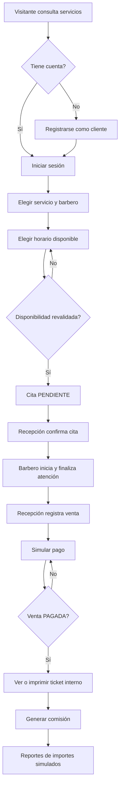
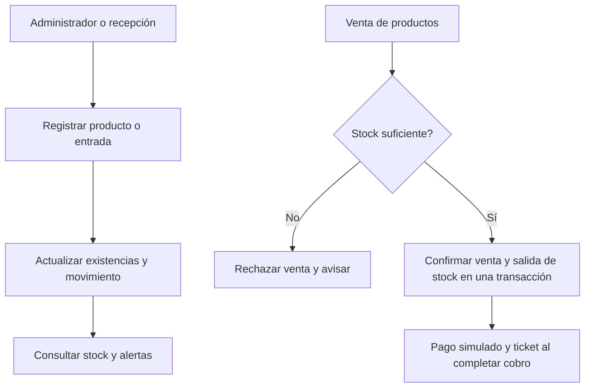

# BarberManager — Flujos de la aplicación

> **BarberManager · v1.0 — propuesta para revisión del equipo**  
> Pagos simulados; el ticket no tiene validez tributaria. Los cambios se aprueban en GitHub antes de codificar.

## Mapa de navegación del proceso principal



## 7. Flujos oficiales

### F01. Registro e inicio de sesión

1. Visitante abre el portal y consulta servicios/barberos.
2. Si desea reservar, inicia sesión; si no tiene cuenta, se registra como cliente.
3. Backend valida unicidad de correo/nombre de usuario, campos y contraseña.
4. Crea `usuarios` (rol `CLIENTE`) y `clientes` asociados en una transacción.
5. Tras login válido se crea sesión y redirige según rol.
6. El sistema verifica permisos en cada petición protegida.

### F02. Reservar cita

1. Cliente autenticado elige **un servicio** y un barbero.
2. El sistema muestra fechas y horas basándose en jornada simple del barbero y citas no canceladas/no ausentes.
3. La duración de la cita corresponde a `servicios.duracion_minutos` en ese momento.
4. Al confirmar, el backend **revalida** disponibilidad dentro de una sección transaccional con bloqueo adecuado al barbero o estrategia equivalente, para impedir reservas concurrentes.
5. Guarda `citas` en `PENDIENTE` con precio y duración históricos.
6. Recepcionista/administrador confirma (`CONFIRMADA`) o cancela (`CANCELADA`).
7. Se admite reprogramación previa al inicio, con la misma validación de disponibilidad.

**Disponibilidad:** dos reservas se solapan si `inicio_existente < fin_nuevo AND fin_existente > inicio_nuevo`; se excluyen estados `CANCELADA` y `NO_ASISTIO`. Se usa el mismo calendario para citas `PENDIENTE`, `CONFIRMADA` y `EN_ATENCION`.

### F03. Atención

1. La cita está `CONFIRMADA`; cliente llega.
2. Se inicia la atención y se crea `atenciones` con `inicio_real`, pasando cita a `EN_ATENCION`.
3. Se finaliza atención con `fin_real`, observaciones y cita `FINALIZADA`.
4. Si el cliente no acude, recepción marca `NO_ASISTIO` antes de empezar.

### F04. Venta de atención o de productos

1. Recepción selecciona una atención finalizada **o** inicia venta solo de productos.
2. El sistema agrega uno o varios `detalle_ventas` (tipo `SERVICIO` o `PRODUCTO`).
3. En una venta de atención se añade exactamente el servicio de la cita; su importe viene del precio histórico de la cita. Se pueden añadir productos.
4. Para productos se verifica existencia al confirmar la venta; se descuentan existencias y se registran salidas de inventario de forma atómica.
5. Se guarda total en `ventas`, inicialmente `PENDIENTE`.
6. No se permite que una atención se cobre en dos ventas diferentes.

### F05. Simular pagos y emitir ticket

1. Recepcionista abre una venta pendiente y selecciona **Simular pago**.
2. Elige método `EFECTIVO`, `YAPE`, `PLIN` o `TARJETA`, e ingresa importe. Son etiquetas de simulación; **no se solicita tarjeta, PIN, token bancario ni se hace transferencia real**.
3. Se valida que el importe sea mayor que cero y no supere el saldo pendiente; se crea `pagos` con `simulado = true`.
4. Se recalcula estado: `PENDIENTE` (sin pagos), `PARCIAL` (faltante) o `PAGADA` (total cubierto).
5. Solo cuando la venta esté `PAGADA` se habilita **Ver/Imprimir ticket**; el ticket se genera a partir de `ventas`, `detalle_ventas` y `pagos`.
6. El ticket indica prominentemente **«COMPROBANTE INTERNO — PAGO SIMULADO — SIN VALIDEZ TRIBUTARIA»**. No se presentan logos SUNAT ni se afirma que sea boleta/factura.
7. El ticket muestra código único, fecha/hora, nombre comercial, cliente si corresponde, ítems, cantidades, precios, total y detalle de métodos de pago simulados. Puede imprimirse desde la vista JSP (CSS `@media print`) sin integración fiscal.
8. Cliente autenticado puede consultar solo tickets de sus propias ventas vinculadas; ventas sin cliente solo internas.

**Ejemplo de ticket:**

```text
BARBERMANAGER — TICKET INTERNO
PAGO SIMULADO — SIN VALIDEZ TRIBUTARIA
Ticket: BM-000001         22/11/2026 18:30
Cliente: Cliente de ejemplo
-----------------------------------------
Corte clásico          1 x S/ 25.00  25.00
Cera para cabello      1 x S/ 15.00  15.00
-----------------------------------------
TOTAL                              S/ 40.00
Pago simulado: YAPE                S/ 40.00
Estado: PAGADA
-----------------------------------------
Documento de práctica académica.
No acredita una transacción real.
```

### F06. Comisión

1. Cuando una atención esté `FINALIZADA` y su venta asociada llegue a `PAGADA`, se genera **una** comisión.
2. La base es el importe del **servicio** registrado en el detalle de venta; los productos no generan comisión.
3. Se utiliza el porcentaje del barbero al momento de generar la comisión y se guarda histórico, junto con base y monto.
4. Comisión inicia `PENDIENTE`; administrador puede cambiarla a `PAGADA` para simular liquidación manual.
5. No existe tabla adicional de liquidaciones en la v1.

### F07. Dashboard

El administrador consulta rango de fechas e indicadores: número de citas por estado, ventas simuladas pagadas, ingresos *simulados*, servicios más solicitados, stock bajo y comisiones pendientes/pagadas. Toda cifra monetaria debe etiquetarse como **simulada**, no como dinero real recibido.

## 8. Estados y transiciones

- **Cita:** `PENDIENTE → CONFIRMADA → EN_ATENCION → FINALIZADA`; desde `PENDIENTE`/`CONFIRMADA` puede pasar a `CANCELADA`; desde `CONFIRMADA` a `NO_ASISTIO`.
- **Venta (estado de pago):** `PENDIENTE → PARCIAL → PAGADA`, o directamente `PENDIENTE → PAGADA` con pago total. V1 no implementa reembolsos ni anulación luego de descuentos de stock.
- **Comisión:** `PENDIENTE → PAGADA`.
- **Usuario/barbero/servicio/producto:** bandera `activo` cuando corresponda; no borrar registros referenciados en historiales.
## 11. Ticket interno (contrato funcional)

**Encabezado obligatorio:** nombre BarberManager/barbería, **PAGO SIMULADO — TICKET INTERNO SIN VALIDEZ TRIBUTARIA**, número único, fecha/hora.  
**Cuerpo:** cliente cuando exista, detalle de servicio/productos, cantidades, precios unitarios, subtotales, total S/, pagos simulados por método y monto.  
**Pie:** «Documento de práctica académica. No representa cobro real ni comprobante SUNAT».

- Se genera mediante JSP HTML/CSS e impresión del navegador (opcional exportar PDF más adelante).
- El número del ticket se conserva al reimprimir.
- No se habilita ticket final hasta venta pagada.
- No debe exponer datos financieros reales ni información ajena al usuario.
## Flujos auxiliares: inventario y administración



**Excepciones:** reservas superpuestas y falta de stock se rechazan sin guardar cambios parciales. Las ventas confirmadas no admiten devoluciones automatizadas en la primera versión.
