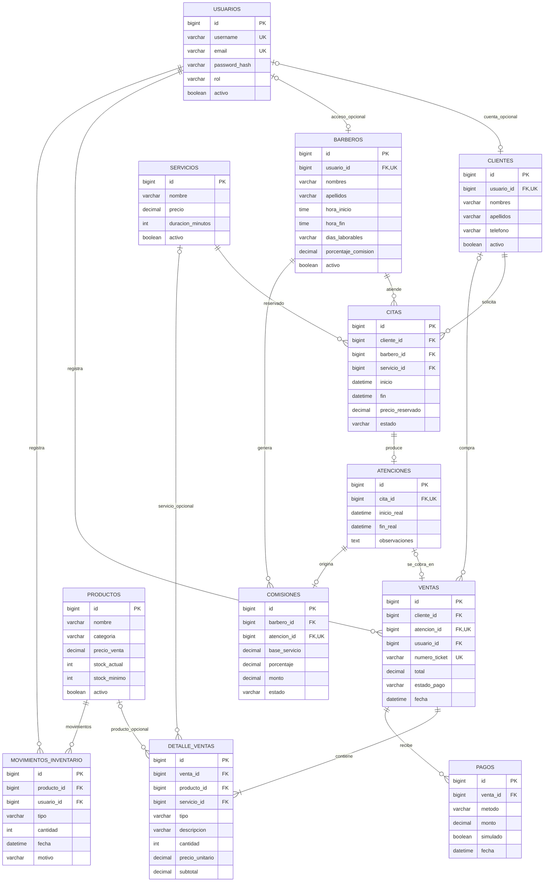

# BarberManager — Modelo entidad-relación (12 tablas)

> **BarberManager · v1.0 — propuesta para revisión del equipo**  
> Pagos simulados; el ticket no tiene validez tributaria. Los cambios se aprueban en GitHub antes de codificar.

Este documento contiene el diagrama Mermaid completo, el diccionario de datos y las reglas de integridad. Es un **modelo lógico propuesto**, no un script SQL listo para ejecutar. Jybran y Alexander deben aprobar los tipos finales para el motor MySQL/MariaDB elegido.

## 9. Modelo entidad-relación simplificado — 12 tablas

> **Modelo lógico propuesto.** Los campos pueden afinarse por Jybran y Alexander antes de generar `schema.sql`. Este esquema no pretende ser SQL ejecutable.

### 9.1. Diccionario resumido y restricciones

**1. `usuarios`:** PK `id`; `username VARCHAR(50) NOT NULL UNIQUE`; `email VARCHAR(120) NOT NULL UNIQUE`; `password_hash VARCHAR(255) NOT NULL`; `rol VARCHAR(20) NOT NULL` (`ADMINISTRADOR`, `RECEPCIONISTA`, `BARBERO`, `CLIENTE`); `activo BOOLEAN NOT NULL DEFAULT TRUE`; timestamps recomendados.

**2. `clientes`:** PK `id`; `usuario_id BIGINT NULL UNIQUE` FK a `usuarios`; `nombres`, `apellidos` obligatorios; `telefono` opcional; `activo` obligatorio. La relación opcional evita forzar cuenta web para clientes registrados por recepción.

**3. `barberos`:** PK `id`; `usuario_id BIGINT NULL UNIQUE` FK a `usuarios`; `nombres`, `apellidos`; `dias_laborables VARCHAR(20)` (p. ej. `1,2,3,4,5,6`; ISO 1=lunes…7=domingo); `hora_inicio`, `hora_fin` (`hora_fin > hora_inicio`); `porcentaje_comision DECIMAL(5,2)` (0–100); `activo`. **Limitación v1:** un mismo rango diario para todos los días que trabaje el barbero; no se modelan pausas ni vacaciones. Si no se necesita personalizar por día, esta simplificación es válida.

**4. `servicios`:** PK `id`; `nombre` obligatorio; `descripcion` opcional; `precio DECIMAL(10,2)` >= 0; `duracion_minutos INT` > 0; `activo`.

**5. `citas`:** PK `id`; FK obligatorias `cliente_id`, `barbero_id`, `servicio_id`; `inicio`, `fin` obligatorios (`fin > inicio`); `precio_reservado DECIMAL(10,2)`; `estado VARCHAR(20)`; `creada_en`. La duración se conserva con `inicio`/`fin`; cualquier cambio posterior en catálogo no altera citas existentes. Índice sobre `(barbero_id,inicio,fin,estado)` para consultas; la prevención de solapamientos requiere validación transaccional en backend (no basta un `UNIQUE`).

**6. `atenciones`:** PK `id`; `cita_id BIGINT NOT NULL UNIQUE` FK `citas`; `inicio_real`, `fin_real` (fin nulo mientras está en curso); `observaciones` opcional. Solo una atención por cita.

**7. `productos`:** PK `id`; `nombre`, `categoria` (texto), `precio_venta DECIMAL(10,2)` >= 0; `stock_actual INT` >= 0; `stock_minimo INT` >= 0; `activo`.

**8. `movimientos_inventario`:** PK `id`; FK `producto_id` y `usuario_id` obligatorias; `tipo VARCHAR(10)` (`ENTRADA`, `SALIDA`, `AJUSTE`); `cantidad INT > 0`; `fecha`; `motivo`; referencia opcional de venta mediante `venta_id BIGINT NULL` FK a `ventas` si se decide incluirla para trazabilidad (no agrega una nueva tabla). Para `AJUSTE`, definir si se utiliza signo/operación adicional; se recomienda `direccion` (`ENTRADA`/`SALIDA`) o sustituir por dos tipos `AJUSTE_ENTRADA`, `AJUSTE_SALIDA` en el contrato final.

**9. `ventas`:** PK `id`; FK `cliente_id BIGINT NULL`, `atencion_id BIGINT NULL UNIQUE`, `usuario_id BIGINT NOT NULL`; `numero_ticket VARCHAR(30) UNIQUE NOT NULL` generado por el sistema; `total DECIMAL(10,2)`; `estado_pago VARCHAR(12)`; `fecha`. La venta de producto sin atención es válida; una atención puede asociarse como máximo a una venta.

**10. `detalle_ventas`:** PK `id`; `venta_id BIGINT NOT NULL`; `tipo VARCHAR(10)` (`SERVICIO`/`PRODUCTO`); `servicio_id BIGINT NULL` FK; `producto_id BIGINT NULL` FK; `descripcion VARCHAR(150)` capturada al vender; `cantidad INT > 0`; `precio_unitario DECIMAL(10,2)`; `subtotal DECIMAL(10,2)`; restricción XOR: tipo `SERVICIO` requiere `servicio_id` y `producto_id` nulo; tipo `PRODUCTO` requiere `producto_id` y `servicio_id` nulo. En v1 solo se incluye un detalle de servicio cuando la venta corresponde a una atención, con `cantidad = 1` y `servicio_id` igual al de su cita.

**11. `pagos`:** PK `id`; `venta_id BIGINT NOT NULL`; `metodo VARCHAR(10)` (`EFECTIVO`, `YAPE`, `PLIN`, `TARJETA`); `monto DECIMAL(10,2)` > 0; `simulado BOOLEAN NOT NULL DEFAULT TRUE`; `fecha`. No se guardan datos de tarjetas ni credenciales externas. El monto total pagado no puede superar el total de venta.

**12. `comisiones`:** PK `id`; FK `barbero_id BIGINT NOT NULL`, `atencion_id BIGINT NOT NULL UNIQUE`; `base_servicio DECIMAL(10,2)`; `porcentaje DECIMAL(5,2)`; `monto DECIMAL(10,2)`; `estado VARCHAR(12)` (`PENDIENTE`, `PAGADA`); `fecha_generacion`, `fecha_pago NULL`. Se genera exclusivamente para servicio finalizado cuya venta esté totalmente pagada.

### 9.2. Consistencia, límites y decisiones pendientes de implementación

1. **Roles sin tabla:** el rol se representa con un código fijo en `usuarios`; se valida estrictamente en backend y BD. Si luego se requiere administración dinámica de permisos, será necesario rediseñar.
2. **Horario simplificado:** `dias_laborables` es un texto codificado; se valida y documenta en Java. No permite excepciones diarias o descansos múltiples.
3. **Un servicio por cita:** simplifica relación `citas → servicios` y evita `detalle_citas`. Si se necesitan paquetes de servicios, hará falta ampliar el modelo.
4. **Venta de servicio solo con atención:** se rechazan servicios sueltos agregados manualmente a ventas sin atención; las ventas sin atención serán solo de productos. Validación en Service.
5. **Ticket único:** `numero_ticket` se genera y almacena al crear la venta; se muestra únicamente cuando la venta queda `PAGADA`. Así no se duplica la numeración y es posible reimprimir el mismo ticket.
6. **No reintegrar inventario por anulación en v1:** no se habilitan cancelaciones de ventas ya confirmadas. Cuando se extienda, debe registrarse movimiento inverso explícito.
7. **Contención de reservas:** para proteger contra dos usuarios que reservan a la vez, el backend debe bloquear la fila de `barberos` (o usar otra estrategia serializable coherente) mientras comprueba y crea la cita.
8. **Stock:** la operación de venta realiza `SELECT ... FOR UPDATE` o bloqueo equivalente al validar y descontar unidades.
9. **Motor BD:** antes del DDL final se acordará MySQL 8 o versión específica de MariaDB instalada en XAMPP; algunas expresiones `CHECK`, identidades y dialectos difieren.
